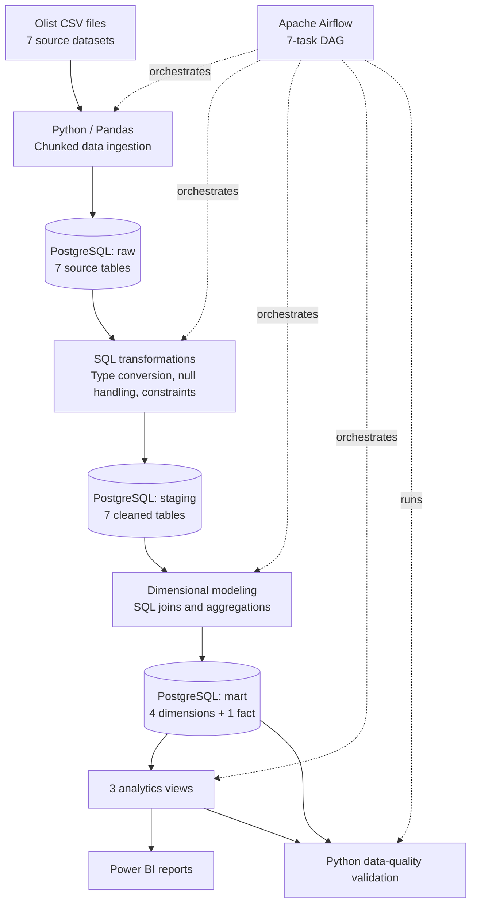
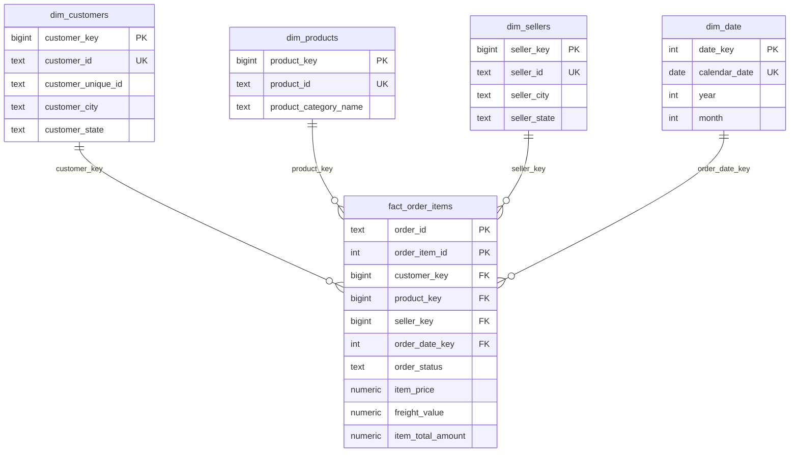

# E-Commerce Data Warehouse & Automated ETL Pipeline

An end-to-end **batch data engineering project** that ingests Brazilian e-commerce data into PostgreSQL, transforms it into an analytics-ready star schema, orchestrates the workflow with Apache Airflow, validates data quality, and presents business insights in Power BI.

**Stack:** Python · Pandas · SQLAlchemy · PostgreSQL · SQL · Apache Airflow · Docker · Power BI

> **Project scope:** A local batch ETL implementation using the [Brazilian E-Commerce Public Dataset by Olist](https://www.kaggle.com/datasets/olistbr/brazilian-ecommerce). Raw, staging, and fact tables use full-refresh loading; dimensions are upserted. It is a portfolio project, not a production deployment or a real-time streaming system.

## Project highlights

| Metric | Result |
|---|---:|
| Source CSV tables used | 7 |
| Total source records ingested | **550,688** |
| Raw / staging tables | **7 / 7** |
| Dimensional model | **4 dimensions + 1 fact** |
| Fact order-item records | **112,650** |
| Automated data-quality checks | **15 passed, 0 failed** in the verified run |
| Airflow orchestration | **7 tasks** in a successful DAG run |
| Analytics views | **3** |
| Power BI report sections | Sales Overview, Product Performance, Seller Performance |

## Architecture



The DAG runs the following tasks in dependency order:

```text
ingest_raw
    ↓
transform_customers_orders
    ↓
transform_remaining_tables
    ↓
build_dimensions
    ↓
build_fact_order_items
    ↓
build_analytics_views
    ↓
validate_data_quality
```

Airflow is configured for **manual triggering** (`schedule=None`) in the current version. The workflow uses task dependencies, a retry policy, and task-level logs.

## Dataset

**Source:** [Olist — Brazilian E-Commerce Public Dataset](https://www.kaggle.com/datasets/olistbr/brazilian-ecommerce)

The project loads these seven files:

| CSV file | Loaded table | Rows |
|---|---|---:|
| `olist_customers_dataset.csv` | `raw.customers` | 99,441 |
| `olist_orders_dataset.csv` | `raw.orders` | 99,441 |
| `olist_order_items_dataset.csv` | `raw.order_items` | 112,650 |
| `olist_products_dataset.csv` | `raw.products` | 32,951 |
| `olist_sellers_dataset.csv` | `raw.sellers` | 3,095 |
| `olist_order_payments_dataset.csv` | `raw.order_payments` | 103,886 |
| `olist_order_reviews_dataset.csv` | `raw.order_reviews` | 99,224 |
| **Total** | | **550,688** |

The full Olist download contains additional CSVs; **only these seven are ingested** by the current pipeline. Download the dataset from its original source rather than expecting the raw CSVs to be committed to this repository.

## Data warehouse design

### Three-layer PostgreSQL architecture

| Schema | Purpose | Implementation |
|---|---|---|
| `raw` | Preserve ingested source data | Seven tables; incoming columns stored as text |
| `staging` | Standardize source records | Data types, trimmed text, empty-string-to-NULL conversion, primary/foreign keys |
| `mart` | Support reporting and analytics | Star schema and aggregated views |

### Star schema



**Fact grain:** One record per order line, uniquely identified by `(order_id, order_item_id)`.

**Measures:** `item_price`, `freight_value`, and `item_total_amount = item_price + freight_value`.

**Modeling considerations:**

- Surrogate dimension keys are used for fact-to-dimension relationships.
- `customer_id` identifies an order-associated customer record; `customer_unique_id` is the Olist field for identifying repeat buyers across orders.
- Payments and reviews are retained in staging, but **not directly joined** to the order-item fact because both may have multiple rows per order and could inflate sums.
- Missing product categories are labeled `Unknown` in the product dimension; missing product measurements are retained as `NULL`.

### Analytics views

| View | Purpose |
|---|---|
| `mart.v_monthly_sales` | Monthly order counts, item values, freight and total values for delivered orders |
| `mart.v_product_performance` | Category-level item value and order/item counts |
| `mart.v_seller_performance` | Seller-level item value and order/item counts |

These views filter on `order_status = 'delivered'`. The reported **item value** and **item + freight value** are transactional measures for delivered orders; they are **not claimed to be recognized revenue or settled cash receipts**.

## Data quality and validation

The Python validator (`scripts/validate_pipeline.py`) executes **15 required checks**:

- Database identity: 1 check.
- Raw-to-staging row counts: 7 checks.
- Dimension completeness: 3 checks.
- Fact row-count reconciliation: 1 check.
- Unique `(order_id, order_item_id)` fact keys: 1 check.
- Financial totals reconciliation: 1 check.
- Missing or invalid fact measures: 1 check.

**Verified outcome:** `Passed: 15`, `Failed: 0`.

The validator also emits **non-blocking warnings**, preserving potentially valid records instead of deleting or imputing them without business justification:

| Warning | Records |
|---|---:|
| Delivered orders without a delivery date | 8 |
| Canceled orders with a delivery date | 6 |
| Products with unknown categories | 610 |
| Zero-value payment records | 9 |

**Refresh behavior:** Each run reloads the `raw` and `staging` source tables and refreshes `mart.fact_order_items`. The dimension tables use `INSERT ... ON CONFLICT DO UPDATE`, while `dim_date` inserts missing dates. These dimension operations do **not** automatically remove rows deleted from a changed source dataset. The current workflow was tested with the same static Olist CSV files across reruns. Per-table and per-SQL-script transactions are used; **the entire DAG is not one atomic transaction**.

## Power BI reporting

The Power BI report connects to the PostgreSQL `mart` analytics views and includes:

**Sales Overview**
- Delivered Orders
- Item Value (BRL)
- Total Order Value (BRL)
- Average Item Value per Order
- Monthly item-value trend and year filter

**Product Performance**
- Top 10 product categories by item value (BRL)

**Seller Performance**
- Top 10 sellers by item value (BRL)

The category and seller views are aggregated across the available years. Unlike the monthly sales view, they do **not** include a time dimension, so a year slicer on Sales Overview does not automatically filter those two views.

## Repository structure

```text
ecommerce-data-warehouse/
├── airflow/
│   ├── dags/
│   │   └── ecommerce_etl_dag.py
│   ├── Dockerfile
│   ├── docker-compose.yaml
│   ├── docker-compose.override.yaml
│   └── requirements-airflow.txt
├── dashboard/
│   └── ecommerce_sales_dashboard.pbix
├── data/
├── scripts/
│   ├── ingest_raw.py
│   ├── run_pipeline.py
│   └── validate_pipeline.py
├── sql/
|   ├── 00_create_scheme.sql
|   ├── 01_data_profiling.sql
│   ├── 02_create_staging.sql
│   ├── 03_complete_staging.sql
│   ├── 04_create_dimensions.sql
│   ├── 05_create_fact_order_items.sql
│   ├── 06_create_analytics_views.sql
|   └── 07_validate_analytics_views.sql
├── .env
├── .gitignore
├── requirements.txt
└── README.md
```

> If the Power BI `.pbix` file has not yet been saved in the listed path, add it before publishing the repository. Runtime logs, credentials and source CSVs should remain excluded from Git.

## Getting started (Windows + local PostgreSQL)

### Prerequisites

- Python 3 and pip
- PostgreSQL server (pgAdmin is optional for running the pipeline)
- Docker Desktop with WSL 2, for Apache Airflow
- Power BI Desktop, to view the `.pbix` report
- The seven Olist CSV files listed above

### 1. Download the data

Download and extract the [Olist dataset](https://www.kaggle.com/datasets/olistbr/brazilian-ecommerce). Place the required CSVs **directly inside `data/`**, matching the current `scripts/ingest_raw.py` configuration:

```text
data/
├── olist_customers_dataset.csv
├── olist_orders_dataset.csv
├── olist_order_items_dataset.csv
├── olist_products_dataset.csv
├── olist_sellers_dataset.csv
├── olist_order_payments_dataset.csv
└── olist_order_reviews_dataset.csv
```

### 2. Create the PostgreSQL database and schemas

Connect to your local PostgreSQL instance and execute:

```sql
CREATE DATABASE ecommerce_dw;
```

Run the following **while connected to `ecommerce_dw`**:

```sql
CREATE SCHEMA IF NOT EXISTS raw;
CREATE SCHEMA IF NOT EXISTS staging;
CREATE SCHEMA IF NOT EXISTS mart;
```

### 3. Configure credentials locally

Create a root-level `.env` file:

```dotenv
DB_HOST=localhost
DB_PORT=5432
DB_NAME=ecommerce_dw
DB_USER=postgres
DB_PASSWORD=YOUR_LOCAL_PASSWORD
```

### 4. Install Python dependencies and run the pipeline

From the repository root, using PowerShell:

```powershell
py -m venv .venv
.\.venv\Scripts\python.exe -m pip install -r requirements.txt
.\.venv\Scripts\python.exe scripts\run_pipeline.py
```

Expected final validation message for the supplied dataset:

```text
=== VALIDATION SUMMARY ===
Passed: 15
Failed: 0
All required data quality checks passed!
PIPELINE COMPLETED SUCCESSFULLY
```

### 5. Run the pipeline with Apache Airflow (optional)

The working Airflow setup uses a custom Docker image and a bind mount from the Windows project into the Airflow worker. From the repository root, enter the `airflow/` directory and build the image:

```powershell
cd airflow
docker build -t ecommerce-airflow:3.3.2 .
```

Create `airflow/.env` containing your Airflow configuration (not the project database credentials):

```dotenv
AIRFLOW_UID=50000
AIRFLOW_IMAGE_NAME=ecommerce-airflow:3.3.2
FERNET_KEY=your_generated_fernet_key
```

Generate a **valid Fernet key** for your own environment using the custom image (run this locally after building it):

```powershell
docker run --rm --entrypoint python ecommerce-airflow:3.3.2 -c "from cryptography.fernet import Fernet; print(Fernet.generate_key().decode())"
```

Copy the output to `FERNET_KEY` in `airflow/.env`. Keep it private, do not share it, and avoid changing it after storing encrypted connections. The Docker Compose override must mount the project folders into the worker as follows:

```yaml
services:
  airflow-worker:
    volumes:
      - ../scripts:/opt/airflow/project/scripts:ro
      - ../sql:/opt/airflow/project/sql:ro
      - ../data:/opt/airflow/project/data:ro
      - ../.env:/opt/airflow/project/.env:ro
```

Do **not** set a global `DB_HOST=host.docker.internal` for the worker: it can interfere with service initialization. The DAG uses `host.docker.internal` **only for its ETL database connections**, while Airflow's internal services continue using Docker Compose networking.

Then, while still in `airflow/`, initialize and start Airflow:

```powershell
docker compose up airflow-init
docker compose up -d
docker compose ps
```

Open **http://localhost:8080**, find **`ecommerce_etl_pipeline`**, and trigger a manual DAG run. Verify all seven tasks succeed and inspect the `validate_data_quality` task logs.

> The local PostgreSQL server must accept connections originating from Docker Desktop. A different operating system or database deployment may require a different host and network configuration. The provided Docker Compose setup is for local development, not a secured production installation.

### 6. Validate analytics-view totals (optional)

The **15 automated checks** validate the base pipeline but do not currently reconcile all three analytics views. For an additional manual verification in pgAdmin, run:

```sql
SELECT
    (SELECT SUM(item_value_brl) FROM mart.v_monthly_sales) AS monthly_item_value,
    (SELECT SUM(item_value_brl) FROM mart.v_product_performance) AS category_item_value,
    (SELECT SUM(item_value_brl) FROM mart.v_seller_performance) AS seller_item_value,
    (SELECT SUM(item_price) FROM mart.fact_order_items
     WHERE order_status = 'delivered') AS delivered_fact_item_value;
```

The four results should agree for the current dataset.

### 7. Open the Power BI report

Open `dashboard/ecommerce_sales_dashboard.pbix` in Power BI Desktop and reconnect to the local PostgreSQL `ecommerce_dw` database if prompted. Refresh the imported model after ETL runs to display updated view results.

### 8. Verify Git exclusions before publishing

Ensure `.gitignore` excludes local secrets, raw CSVs, and Airflow runtime files. For example:

```gitignore
.venv/
__pycache__/
*.pyc
.env
.env.*
!.env.example
data/*.csv
data/raw/
airflow/logs/
airflow/config/
```
## Data attribution

Dataset: **Brazilian E-Commerce Public Dataset by Olist**, hosted on [Kaggle](https://www.kaggle.com/datasets/olistbr/brazilian-ecommerce). All dataset rights and usage conditions remain with the original providers. This repository documents an independent educational data engineering implementation.
